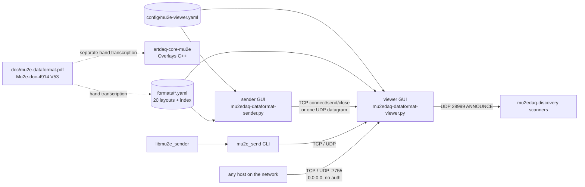

# mu2edaq-dataformat-viewer

> PyQt6 viewer and sender that decode and construct Mu2e ROC packets field by
> field from hand-written YAML layouts of Mu2e-doc-4914, with a TCP/UDP
> listener on 7755 and a small C sender library and CLI

| | |
|---|---|
| Repository | `Mu2e/mu2edaq-dataformat-viewer` (public, issues enabled) |
| Language | Python 3.9+ (PyQt6, PyYAML); C++17 with C linkage for `cpp/` |
| Ports | 7755/tcp or 7755/udp listen (operator-started); 28999/udp discovery responder when `mu2edaq-discovery` is installed |
| Depends on | `mu2edaq-discovery` (optional import). Encodes the same wire layouts as `artdaq-core-mu2e` overlays, with no link between them |
| Version | `t01.00.00` |
| Size | 2628 lines: Python 2046 (viewer 1101, sender 786, config 159), C/C++ 393 + CMake 47, shell 142; plus 21 YAML format files (3265 lines) |

## Purpose

An expert diagnostic in the spirit of the NOvA EventMemoryViewer
(`mu2edaq-dataformat-viewer.py:9`). The viewer takes raw bytes (typed hex, a
binary file, or a TCP/UDP packet) and shows each field of a chosen packet
layout with hex, binary, decimal and decoded values. The sender builds a
packet field by field from the same layouts and transmits it. The layouts
are data, in `formats/*.yaml`, so new packet types need no code change.

The layouts are a hand transcription of Mu2e-doc-4914, the ROC packet
protocol, shipped as `doc/mu2e-dataformat.pdf` (V53, 21 Feb 2026). The DTC
software in `artdaq-core-mu2e` encodes the same layouts again in C++. Nothing
connects the two, and they disagree (DFV-001).

## Architecture

Threading (viewer): the Qt main thread owns all widgets. `Start listening`
binds one socket and starts a daemon thread (`_accept_loop` or `_udp_loop`,
`mu2edaq-dataformat-viewer.py:1013-1030`); TCP spawns one more daemon thread
per connection (`_handle_conn`, `:1032`). Received bytes reach the GUI only
through the `_Receiver.data_received` Qt signal (`:177-179`, `:1028`, `:1043`), so no
widget is touched off the main thread. The discovery responder is another
daemon thread started in `__main__` (`:1087-1092`).

## Components

| File | Role |
|---|---|
| `mu2edaq-dataformat-viewer.py` | Viewer. `load_yaml_formats` (`:61`), `get_word` with bounds check (`:82`), `extract_bits` (`:91`), `parse_fields` (`:108`), `hex_str_to_bytes` (`:135`); `Mu2eViewer` GUI; built-in `PACKET_TYPE_MAP` for auto-detect (`:164-174`); listener (`:975-1053`). |
| `mu2edaq-dataformat-sender.py` | Sender. Duplicate `load_yaml_formats`; `set_bits` (`:75`), `buf_size_for_format` (`:101`); `FieldRow` widgets; `_assemble` and `_send` (`:664-760`). |
| `config/config.py` | Shared loader: defaults, cwd-relative search, deep merge, `CRS_PORT_LISTEN` override (`:57-115`). Imported as package `config` from the script directory. |
| `config/mu2e-viewer.yaml` | Shipped configuration (`formats_dir: ../formats`, port 7755). Byte-identical to `mu2edaq-config/config-main/mu2edaq-dataformat-viewer/mu2e-viewer.yaml`. |
| `formats/*.yaml` | 20 packet layouts plus `packet_type_index.yaml`. Schema: `man/man5/mu2edaq-dataformat-formats.yaml.5`. |
| `cpp/` | `libmu2e_sender` (static by default) and `mu2e_send` CLI, CMake ≥3.15, C++17. Built cleanly out of tree on macOS 2026-10-06. POSIX sockets only. |
| `start-`/`stop-mu2edaq-dataformat-viewer.sh` | Control-room launcher (nohup, PID file, log) and stopper (SIGTERM, `CRS_STOP_TIMEOUT`, SIGKILL). |
| `bootstrap.sh` | Creates `venv/`, installs `mu2edaq-discovery` (sibling or GitHub) and `requirements.txt`; `--dev` adds pytest. |
| `test/test.dat`, `test/test2.dat` | 20-byte big-endian heartbeat sample and 2048 bytes of what looks like random data. No test code. |
| `doc/mu2e-dataformat.pdf` | Mu2e-doc-4914 V53, the source the YAML was transcribed from. |

## Interfaces

Network input, discovery, the C API, and the field-by-field comparison of
the YAML layouts against the specification and the `artdaq-core-mu2e`
overlays are in [INTERFACES.md](INTERFACES.md).

## Configuration

`config/mu2e-viewer.yaml`, found by a search relative to the **current
directory** (`./mu2e-viewer.yaml`, `./config.yaml`, `./config/mu2e-viewer.yaml`,
`./config/config.yaml`; `config/config.py:48-52`). The start script `cd`s to
the checkout so the shipped file is found. Run from elsewhere, the built-in
`formats_dir: "."` resolves to the checkout root and no formats load
(verified; DFV-008). `CRS_PORT_LISTEN` overrides `viewer.port`
(`config/config.py:111-113`). Keys: `man/man5/mu2e-viewer.yaml.5`.

## Operations

GUI on the control-room VNC desktop. `crs-app start dataformat-viewer` runs
`start-mu2edaq-dataformat-viewer.sh` (session `daq-aux`,
`ports: {listen: 7755}`). The listener is off until the operator presses
**Start listening**. State is `dataformat-viewer.pid` and an unrotated
`dataformat-viewer.log` in the checkout. There is no daemon behaviour beyond
that, so no separate OPERATIONS.md.

## Interactions with other packages

| Package | Relation | Evidence |
|---|---|---|
| `mu2edaq-discovery` | optional import; announces `dataformat-viewer` | `mu2edaq-dataformat-viewer.py:1089` |
| `artdaq-core-mu2e` | independent C++ encoding of the same layouts; no code link, no consistency check | `formats/heartbeat_packet.yaml:108-226` vs `artdaq-core-mu2e/Overlays/DTC_Packets/DTC_HeartbeatPacket.cpp:36-41` |
| `mu2edaq-controlroom-setup` | launches it (`crs-app start dataformat-viewer`) | `mu2edaq-controlroom-setup/config/apps.yaml:117-125` |
| `mu2edaq-desktop` | desktop launcher entry | `mu2edaq-desktop/config/apps.yaml:117-125` |
| `mu2edaq-config` | snapshot of `config/mu2e-viewer.yaml` | `mu2edaq-config/config-main/mu2edaq-dataformat-viewer/mu2e-viewer.yaml` |

## Review findings

Staged in [ISSUES-PENDING.md](ISSUES-PENDING.md): 1 × S2, 6 × S3, 3 × S4.

| ID | Sev | Title |
|---|---|---|
| DFV-001 | S2 | `[formats] heartbeat, data-request and debug-header YAML layouts disagree with Mu2e-doc-4914 V53 and with artdaq-core-mu2e; nothing checks consistency` |
| DFV-002 | S3 | `[formats] YAML value tables drift from the overlay enums, three formats cannot be displayed, and nothing validates the YAML` |
| DFV-003 | S3 | `[viewer] default big-endian word order is the opposite of the DTC byte order, and auto-detect misreads payload and little-endian packets` |
| DFV-004 | S3 | `[viewer] the listener accepts unbounded input from any host and truncated packets decode silently` |
| DFV-005 | S3 | `[viewer] word size 2 or 4 bytes makes every decode fail with "Parse error"` |
| DFV-006 | S3 | `[discovery] the viewer announces its port at launch, before anything listens` |
| DFV-007 | S3 | `[tests] test/ holds sample data but no tests, and there is no CI` |
| DFV-008 | S4 | `[config] config search is relative to the current directory; launched elsewhere the viewer loads no formats` |
| DFV-009 | S4 | `[cpp] libmu2e_sender is POSIX-only and lets SIGPIPE kill the caller` |
| DFV-010 | S4 | `[docs] README format count, sample path and the "standard big-endian" claim are wrong` |

### Verdicts requested by the review brief

- **YAML vs overlays:** compared field by field for the Data Header,
  Heartbeat and Data Request packets (and the Debug Header against the
  spec). Data Header: all 8 words agree among YAML, spec and overlay; the
  subsystem-ID value table differs. Heartbeat and Data Request: the YAML
  places fields in different bits from both the spec it was transcribed
  from and the overlay, which agree with each other. **S2** (DFV-001).
  Tables in [INTERFACES.md §4](INTERFACES.md#4-yaml-layouts-versus-mu2e-doc-4914-and-artdaq-core-mu2e).
- **Bounds checks on untrusted packets:** decoding cannot read out of range
  (`get_word` returns `None` past the end and the field is skipped), and
  Python is memory-safe. The gaps are resource and integrity: TCP input is
  read to EOF with no size or time limit, any host can push data, and
  missing fields are dropped without a truncation marker (DFV-004).
- **`test/` is empty of tests:** it holds two `.dat` samples and no test
  code; `bootstrap.sh --dev` installs pytest for nothing (DFV-007).
- **Discovery `meta` (CONTRACT §9.5):** the responder is built without
  `meta`, so the string-only rule holds. The port is announced before the
  listener exists (DFV-006).
